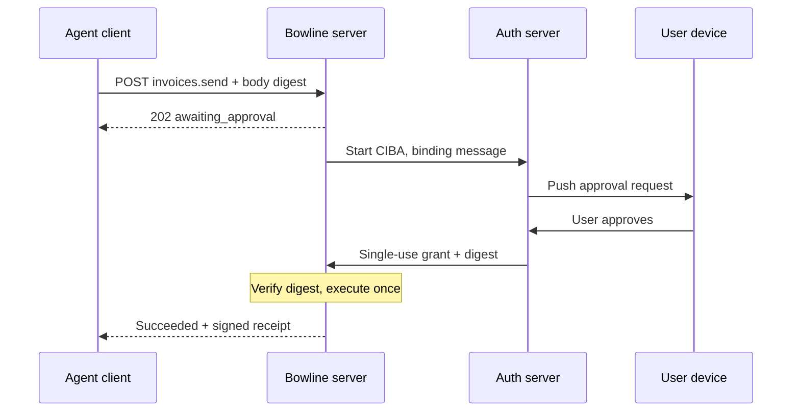

# Bowline: Agent Capability Protocol (Draft Spec v0.1)

Oct 22, 2026 · Rico

## Status, abstract and motivation

Bowline is a thin agent layer over HTTP, OpenAPI 3.1 and OAuth 2.1 that lets models use remote capabilities with near-zero idle context cost, explicit contracts and mandatory remote security. Status: strawman draft v0.1 for discussion. A TypeScript reference implementation and a benchmark exist (see `docs/benchmark-protocol.md`). On 2026-10-26 the strategy changed: the core ideas go to MCP as enhancement proposals instead of shipping Bowline as a standalone protocol. See the decision at the end of this document.

Bowline fixes five gaps observed in today's agent-to-tool integrations:

- **Context tax.** Full tool schemas load into every session before the first user message. Bowline discloses capabilities in three tiers and caches by content hash.
- **Weak contracts.** Output shapes, side effects and idempotency are optional or implicit. Bowline makes them mandatory descriptor fields.
- **Stateful transport.** Long-lived sessions complicate load balancing and failover. Bowline is stateless request/response; long work is an async task resource.
- **Optional remote security.** Unauthenticated remote servers are common in practice. Bowline has no unauthenticated remote profile and carries a delegation chain in every token.
- **Tool poisoning and injection.** Descriptions can change silently and tool output can carry instructions. Bowline signs and pins descriptors and labels all output as untrusted data.
  Bowline deliberately reuses existing standards rather than inventing new transports, auth or schema languages.

## Design principles and scope

Bowline covers exactly one relationship: an agent using a capability exposed by a server. Agent-to-agent delegation is out of scope and left to A2A; an A2A agent MAY expose its skills as Bowline capabilities.

1. **Pay for context only when used.** The always-loaded footprint is one short line per capability group.
2. **The interface is deterministic, even if the model is not.** Every capability declares inputs, outputs, effects and idempotency.
3. **Stateless by default.** No session affinity; state lives in addressable resources.
4. **No anonymous remote.** Every remote call is authenticated, scoped and attributable to a human, an agent and a client.
5. **Data is never instruction.** Capability output is labelled untrusted and kept apart from descriptions.
6. **Reuse the factory.** HTTP semantics, OpenAPI 3.1, OAuth 2.1, RFC 9457 errors, W3C Trace Context. Bowline adds only what agents need on top.
7. **One meaning, two bindings.** Local (stdio) and remote (HTTPS) share identical message semantics.

## Terminology and conformance

The key words MUST, MUST NOT, SHOULD and MAY are used as in RFC 2119 and RFC 8174.

| Term         | Meaning                                                                            |
| ------------ | ---------------------------------------------------------------------------------- |
| User         | The human on whose behalf work is done and who grants consent                      |
| Client       | The application hosting the model (a chat app, an IDE, an agent runtime)           |
| Agent        | The model-driven process inside the client that decides which capabilities to call |
| Server       | The system exposing capabilities through a Bowline manifest                           |
| Capability   | One callable operation, for example `invoices.create`                              |
| Group        | A named set of related capabilities, the unit of tier 1 disclosure                 |
| Descriptor   | The machine-readable definition of one capability (tier 2)                         |
| Manifest     | The server's tier 1 index of groups, signed and content-addressed                  |
| Effect class | `read`, `write`, `destructive` or `external`, declared per capability              |
| Task         | A server resource representing long-running work, addressed by URL                 |
| Receipt      | A signed record of a completed write, returned to the client                       |

## Discovery

A server publishes its manifest at `/.well-known/bowline` and clients disclose capabilities to the model in three tiers, fetching each tier only when needed.

| Tier         | Content                                                    | Loaded                                       | Target size              |
| ------------ | ---------------------------------------------------------- | -------------------------------------------- | ------------------------ |
| 1 Manifest   | One line per group: name, purpose, effect classes present  | Once per client, cached                      | 5 to 20 tokens per group |
| 2 Descriptor | Signature, output type, effects, scopes for one capability | When the agent selects a group or capability | 40 to 150 tokens         |
| 3 Docs       | Examples, edge cases, long prose                           | On error or explicit request                 | Unbounded                |

Rules:

- The manifest and every descriptor MUST be content-addressed: the URL ends in its SHA-256 digest, and the response carries `ETag` equal to that digest.
- Content-addressed resources MUST be served with `Cache-Control: public, max-age=31536000, immutable`. The manifest index URL itself SHOULD use a short max-age and `ETag` revalidation.
- Clients SHOULD share caches across users of the same server; descriptors contain no user data.
- A client MAY expose a single meta-tool to the model (`bowline.describe(group)`) instead of injecting tier 2 eagerly.
- Servers with more than 50 capabilities SHOULD offer `GET /bowline/search?q=` returning ranked capability ids.

## Capability descriptor

A descriptor is an OpenAPI 3.1 operation with `x-bowline` extensions, plus a compact signature the client shows to the model.

**Compact signature dialect (BSig).** A TypeScript-like line that compiles losslessly to JSON Schema 2020-12. Example: `create(customerId: id, lines: Line[1..100], dueDate?: date, currency = "EUR"): Invoice`. Named types are defined once per group and cached. Clients MUST be able to expand BSig to JSON Schema for validation.

**Required fields per capability:**

- `id`: stable dotted name, `invoices.create`
- `version`: semver; breaking changes MUST bump major and MUST be served under a new descriptor digest
- `summary`: one sentence, at most 120 characters, written for a model
- `input` and `output`: BSig or JSON Schema; output is mandatory
- `effect`: `read` | `write` | `destructive` | `external`
- `idempotent`: boolean; non-idempotent writes MUST accept `Idempotency-Key`
- `scopes`: OAuth scopes required
- `async`: `never` | `may` | `always`
  **Optional hints:** `cost` (unit and estimate), `latencyMs` (p50, p95), `dryRun` (supported or not), `deprecated` and `sunset` dates, mirroring the HTTP `Deprecation` and `Sunset` headers.

**Effect class semantics.** `read` has no observable side effects. `write` changes state inside the server's domain and is reversible. `destructive` deletes or irreversibly changes data. `external` causes effects outside the server's domain, such as sending email, moving money or messaging a third party.

## Sample manifest and descriptor

The examples model a fictional billing service, `billing.example.com`. Digests are shortened for readability.

**Tier 1 manifest**, `GET /.well-known/bowline`:

```json
{
  "bowline": "0.1",
  "server": {
    "name": "Example Billing",
    "publisher": "did:web:billing.example.com",
    "base": "https://billing.example.com/bowline/v1"
  },
  "auth": {
    "issuer": "https://auth.example.com",
    "metadata": "https://auth.example.com/.well-known/oauth-authorization-server",
    "dpop": "required"
  },
  "groups": [
    {
      "name": "customers",
      "summary": "Look up and update customer records",
      "effects": ["read", "write"],
      "descriptors": "/bowline/v1/d/customers@sha256-8f3a1c"
    },
    {
      "name": "invoices",
      "summary": "Create, send, void and query invoices",
      "effects": ["read", "write", "destructive", "external"],
      "descriptors": "/bowline/v1/d/invoices@sha256-2be90d"
    },
    {
      "name": "reports",
      "summary": "Generate revenue and aging reports (async)",
      "effects": ["read"],
      "descriptors": "/bowline/v1/d/reports@sha256-c771e4"
    }
  ],
  "signature": {
    "alg": "EdDSA",
    "kid": "did:web:billing.example.com#bowline-2026",
    "value": "eyJhbGciOiJFZERTQSJ9..k3Fz"
  }
}
```

What the model sees from this manifest, rendered by the client (about 45 tokens):

```
billing.customers  Look up and update customer records [read, write]
billing.invoices   Create, send, void and query invoices [read, write, destructive, external]
billing.reports    Generate revenue and aging reports [read, async]
```

**Tier 2 descriptor** for `invoices.send`, one entry of the `invoices` group document:

```json
{
  "id": "invoices.send",
  "version": "2.1.0",
  "summary": "Email a finalized invoice to the customer's billing contact",
  "sig": "send(invoiceId: id, message?: string[..500]): SendResult",
  "types": {
    "SendResult": "{ invoiceId: id, sentTo: email, sentAt: datetime, receipt: Receipt }"
  },
  "effect": "external",
  "idempotent": false,
  "scopes": ["invoices:send"],
  "async": "never",
  "stepUp": "required",
  "dryRun": true,
  "latencyMs": { "p50": 300, "p95": 1200 },
  "http": { "method": "POST", "path": "/bowline/v1/call/invoices.send" },
  "openapi": "/openapi.json#/paths/~1invoices~1{id}~1send/post"
}
```

The `openapi` pointer links the capability to the existing REST operation, so an API that already has an OpenAPI spec becomes Bowline-compliant by adding `x-bowline` fields and a manifest.

## Security model

Every remote Bowline call MUST carry a sender-constrained OAuth 2.1 access token that names the user, the agent and the client; a server that answers any `/bowline/` path without one is non-conformant.

**Authorization.**

- OAuth 2.1 authorization code flow with PKCE for user delegation. Clients identify themselves with a Client ID Metadata Document (an HTTPS URL as `client_id`), so no per-server dynamic registration is needed.
- Tokens MUST be bound to a client key with DPoP (RFC 9449). A stolen bearer token is useless without the private key.
- Machine-only integrations use client credentials with private-key JWT. They act as themselves, never as a user.
  **Delegation chain.** Clients obtain call tokens through OAuth Token Exchange (RFC 8693). The resulting token carries `sub` (the user), `act` (the agent instance, nested if an agent delegates further) and `client_id`. Servers MUST log all three. Audit trails then read "agent A, running in client C, acting for user U, did X".

**Scopes map to effect classes.** Scopes follow `<group>:<verb>` and a capability's scopes MUST be at least as strong as its effect class. Consent screens SHOULD group scopes by effect class: read, change, delete, act externally. Tokens SHOULD be short-lived, 15 minutes or less.

**Step-up.** Capabilities with `stepUp: required`, and by default all `destructive` and `external` ones, need a fresh, single-use approval bound to the exact request. See Flow C.

**Descriptor integrity.**

- The manifest MUST be signed (JWS, EdDSA) by a key resolvable from the publisher's `did:web` or JWKS.
- Clients MUST pin the manifest digest at consent time. If a descriptor digest changes, the client MUST show the user a diff of changed summaries, effects or scopes and re-request consent before use. This blocks silent "rug pull" description changes.
- Registries MAY add publisher verification, like package signing.
  **Untrusted output.** Every response body is data. Responses MUST include `Bowline-Content-Trust: untrusted` and a `provenance` object naming the server and, where relevant, the upstream source (an email sender, a web page). Clients MUST present tool output to the model inside a data channel separate from instructions and descriptions, and MUST NOT let output change the active capability set.

## Flow A: synchronous call

A synchronous call is one stateless `POST` that returns `200` with a typed result; any server instance behind a plain load balancer can answer it. Example: the agent looks up a customer, a `read` capability.

**Step 1. Client fetches the descriptor** (usually a cache hit):

```http
GET /bowline/v1/d/customers@sha256-8f3a1c HTTP/1.1
Host: billing.example.com
Accept: application/bowline+json
If-None-Match: "sha256-8f3a1c"

HTTP/1.1 304 Not Modified
ETag: "sha256-8f3a1c"
Cache-Control: public, max-age=31536000, immutable
```

**Step 2. The call:**

```http
POST /bowline/v1/call/customers.get HTTP/1.1
Host: billing.example.com
Authorization: DPoP eyJhbGciOiJFUzI1NiJ9.eyJzdWIiOiJ1c2VyOnJpY28iLCJhY3QiOnsic3ViIjoiYWdlbnQ6N2YxIn19.sig
DPoP: eyJ0eXAiOiJkcG9wK2p3dCJ9.eyJodG0iOiJQT1NUIiwiaHR1IjoiaHR0cHM6Ly9iaWxsaW5nIn0.sig
Content-Type: application/json
Bowline-Version: 0.1
Bowline-Descriptor: sha256-8f3a1c
traceparent: 00-4bf92f3577b34da6a3ce929d0e0e4736-00f067aa0ba902b7-01

{"customerId": "cus_4821"}
```

```http
HTTP/1.1 200 OK
Content-Type: application/bowline+json
Bowline-Content-Trust: untrusted
RateLimit-Policy: "default";q=600;w=60
RateLimit: "default";r=597;t=42
Cache-Control: private, no-store

{
  "result": {
    "customerId": "cus_4821",
    "name": "Atelier Nord GmbH",
    "billingEmail": "billing@atelier-nord.example",
    "openBalance": { "amount": "1240.00", "currency": "EUR" }
  },
  "provenance": { "server": "did:web:billing.example.com", "source": "crm" }
}
```

Notes:

- `Bowline-Descriptor` tells the server which contract the client validated against. A server that no longer serves that digest MUST answer `409` with problem type `descriptor-outdated` and the new digest.
- For `write` capabilities the client sends `Idempotency-Key: <uuid>`; a retry with the same key returns the original result and the server MUST NOT repeat the effect.
- Writes return a `receipt` (JWS over request digest, result digest, `sub`, `act`, timestamp) inside `result`.

## Flow B: async task

Long work returns `202 Accepted` with a task URL; the client then polls, receives a webhook, or opens a resumable stream, and no connection has to stay open. Example: a revenue report for Q3.

**Step 1. Start the task:**

```http
POST /bowline/v1/call/reports.revenue HTTP/1.1
Host: billing.example.com
Authorization: DPoP eyJ...
DPoP: eyJ...
Content-Type: application/json
Bowline-Version: 0.1
Bowline-Descriptor: sha256-c771e4
Idempotency-Key: 6c1e2a7e-3b0f-4f43-9d55-1a2f0b9e7c11
Bowline-Callback: https://client.example.net/bowline/hooks/t

{"from": "2026-07-01", "to": "2026-09-30", "groupBy": "month"}
```

```http
HTTP/1.1 202 Accepted
Location: /bowline/v1/tasks/tsk_9Qm2
Retry-After: 5
Content-Type: application/bowline+json

{
  "task": "/bowline/v1/tasks/tsk_9Qm2",
  "state": "running",
  "progress": { "percent": 0 },
  "stream": "/bowline/v1/tasks/tsk_9Qm2/events",
  "cancel": "/bowline/v1/tasks/tsk_9Qm2",
  "expiresAt": "2026-10-29T13:22:00Z"
}
```

**Step 2, option a. Poll** (any server instance can answer; task state lives in shared storage):

```http
GET /bowline/v1/tasks/tsk_9Qm2 HTTP/1.1
Authorization: DPoP eyJ...
DPoP: eyJ...

HTTP/1.1 200 OK
Retry-After: 10

{ "state": "running", "progress": { "percent": 60, "note": "aggregating August" } }
```

**Step 2, option b. Webhook.** On completion the server posts to `Bowline-Callback`. The body is signed with HTTP Message Signatures (RFC 9421) using the key from the manifest, and contains only the task URL and state. The client fetches the result with its own token, so no data leaks through the callback.

```http
POST /bowline/hooks/t HTTP/1.1
Host: client.example.net
Signature-Input: bowline=("@method" "@path" "content-digest");keyid="bowline-2026";created=1761139400
Signature: bowline=:MEUCIQDk...:
Content-Digest: sha-256=:X48E9q...:

{ "task": "https://billing.example.com/bowline/v1/tasks/tsk_9Qm2", "state": "succeeded" }
```

**Step 2, option c. Resumable stream** (optional, server-sent events):

```http
GET /bowline/v1/tasks/tsk_9Qm2/events HTTP/1.1
Accept: text/event-stream
Last-Event-ID: 41

HTTP/1.1 200 OK
Content-Type: text/event-stream

id: 42
event: progress
data: {"percent": 80}

id: 43
event: state
data: {"state": "succeeded"}
```

If the stream drops, the client reconnects to any instance with `Last-Event-ID`; event history is kept for the task's lifetime.

**Step 3. Read the result:**

```http
GET /bowline/v1/tasks/tsk_9Qm2 HTTP/1.1

HTTP/1.1 200 OK
Bowline-Content-Trust: untrusted

{
  "state": "succeeded",
  "result": { "months": [ { "month": "2026-07", "revenue": "84210.00" } ], "currency": "EUR" },
  "provenance": { "server": "did:web:billing.example.com", "source": "ledger" }
}
```

Task states: `queued`, `running`, `awaiting_approval`, `succeeded`, `failed`, `cancelled`, `expired`. `DELETE` on the task URL cancels it and returns `202`.

## Flow C: step-up approval

A `destructive` or `external` call never executes on the agent's token alone: the server parks it as a task in `awaiting_approval`, the user approves the exact request on a trusted device, and only then does it run. The approval is bound to a digest of the request body, so the agent cannot change parameters after the user said yes. Example: the agent sends invoice `inv_7731` to the customer.



The agent only ever holds the parked task URL; the approval travels between the user's device, the authorization server and the Bowline server.

**Step 1 (optional). Dry run,** so the client can show the user what will happen:

```http
POST /bowline/v1/call/invoices.send?dryRun=true HTTP/1.1
Authorization: DPoP eyJ...
DPoP: eyJ...
Content-Type: application/json

{"invoiceId": "inv_7731", "message": "Thanks for your order."}

HTTP/1.1 200 OK

{ "wouldDo": { "sendTo": "billing@atelier-nord.example", "amount": "1240.00 EUR", "attachments": ["INV-7731.pdf"] } }
```

**Step 2. Real call:**

```http
POST /bowline/v1/call/invoices.send HTTP/1.1
Authorization: DPoP eyJ...
DPoP: eyJ...
Content-Type: application/json
Content-Digest: sha-256=:q1Yb0Kp9...:
Idempotency-Key: 0f8b3d2c-9a71-4c1e-b6f0-55e2d4a1c9aa

{"invoiceId": "inv_7731", "message": "Thanks for your order."}
```

```http
HTTP/1.1 202 Accepted
Location: /bowline/v1/tasks/tsk_A7x

{
  "state": "awaiting_approval",
  "approval": {
    "id": "apr_55c",
    "method": "ciba",
    "bindingMessage": "Send invoice INV-7731 (1,240.00 EUR) to billing@atelier-nord.example",
    "requestDigest": "sha-256=:q1Yb0Kp9...:",
    "expiresAt": "2026-10-22T13:37:00Z"
  }
}
```

**Step 3. Out-of-band approval.** The server asks its authorization server to start a Client-Initiated Backchannel Authentication (OpenID CIBA) request for the user in `sub`, carrying `bindingMessage`. The user sees the message on their phone or in the client's native approval UI, authenticates, and approves or denies. The agent never sees or handles the approval credential.

**Step 4. Execution.** On approval the authorization server issues a single-use approval grant tied to `apr_55c` and `requestDigest`. The server verifies the digest against the parked request, executes once, and moves the task to `succeeded`. The client learns this through polling, webhook or stream, exactly as in Flow B.

```http
GET /bowline/v1/tasks/tsk_A7x HTTP/1.1

HTTP/1.1 200 OK

{
  "state": "succeeded",
  "result": {
    "invoiceId": "inv_7731",
    "sentTo": "billing@atelier-nord.example",
    "sentAt": "2026-10-22T13:24:51Z",
    "receipt": "eyJhbGciOiJFZERTQSJ9.eyJyZXEiOiJzaGEtMjU2OnExWWIwS3A5Li4uIiwiYXBwcm92YWwiOiJhcHJfNTVjIn0.sig"
  }
}
```

**Outcomes.** Denied: task `failed` with problem type `approval-denied`, effect not performed. No answer before `expiresAt`: task `expired`. Changed body on retry: new digest, so a new approval is required; the old one cannot be reused.

**Policy.** Users MAY pre-approve narrow standing rules at consent time, for example "send invoices under 500 EUR to existing customers without asking". Servers enforce these rules; the agent cannot widen them.

## Errors, rate limits, observability

Errors are RFC 9457 problem details extended with fields a model can act on, so agents self-correct instead of retrying blindly.

```http
HTTP/1.1 422 Unprocessable Content
Content-Type: application/problem+json

{
  "type": "https://bowline.dev/problems/invalid-input",
  "title": "Invalid input",
  "status": 422,
  "bowline": {
    "retryable": false,
    "field": "/dueDate",
    "hint": "dueDate must be on or after the invoice date 2026-10-22",
    "docs": "/bowline/v1/docs/invoices.create#dueDate"
  }
}
```

| Problem type          | Status | Retryable | Agent should                                    |
| --------------------- | ------ | --------- | ----------------------------------------------- |
| `invalid-input`       | 422    | No        | Fix the field named in `bowline.field` and retry   |
| `descriptor-outdated` | 409    | Yes       | Fetch the new descriptor, revalidate, retry     |
| `insufficient-scope`  | 403    | No        | Ask the user for the scope in `bowline.scope`      |
| `approval-denied`     | 403    | No        | Report to the user, do not retry                |
| `rate-limited`        | 429    | Yes       | Wait `Retry-After` seconds                      |
| `unavailable`         | 503    | Yes       | Back off, retry with the same `Idempotency-Key` |

Rate limits use the IETF `RateLimit` and `RateLimit-Policy` headers on every response. Every request MUST carry W3C `traceparent`; servers SHOULD emit OpenTelemetry spans named `bowline.call <capability id>` with attributes for `sub`, `act`, effect class and outcome. One agent run then appears as one trace across all servers it touched.

## Local binding and MCP bridge

Local tools use the same messages over stdio as newline-delimited JSON, so a capability behaves identically whether it runs on the laptop or in the cloud.

- **Local binding.** Each line is an envelope `{"op": "call" | "describe" | "task", "id": ..., "body": ...}` mirroring the HTTP path and body. Auth is the operating system's process boundary; tokens are not used. Effect classes and step-up still apply: the client shows its own approval UI for `destructive` and `external` calls.
- **Bowline to MCP.** A bridge exposes each Bowline capability as an MCP tool, with the tier 1 summary as description, and fetches tier 2 lazily via a `describe` tool. Existing MCP clients can use Bowline servers on day one.
- **MCP to Bowline.** A bridge wraps an MCP server, maps tools to capabilities, and marks every capability `effect: external` until a human annotates it. Annotations are stored in a sidecar manifest the bridge signs.
- **OpenAPI to Bowline.** A generator reads an OpenAPI 3.1 document, proposes groups by tag, derives BSig from schemas and effect classes from HTTP methods (`GET` read, `PUT`/`PATCH`/`POST` write, `DELETE` destructive). Humans review the output before publishing.

## Comparison: Bowline vs MCP vs A2A

Bowline competes with MCP on agent-to-tool access and complements A2A, which targets agent-to-agent delegation. MCP column checked against revision 2026-07-28 (changelog) and A2A against v1.0.0 on 2026-10-26. Rows were verified against the MCP tools and authorization pages, the MCP ext-auth repository, and A2A sections 4.4.5 and 8. Still unverified: MCP annotation field names, A2A message deduplication (the last quarter of the A2A spec was not read).

| Dimension               | Bowline (this draft)                                                    | MCP                                                                            | A2A                                                  |
| ----------------------- | -------------------------------------------------------------------- | ------------------------------------------------------------------------------ | ---------------------------------------------------- |
| Primary purpose         | Agent uses a capability                                              | Agent uses tools, resources, prompts                                           | Agent delegates work to another agent                |
| Wire format             | HTTP semantics, JSON bodies; stdio for local                         | JSON-RPC 2.0 over stdio or Streamable HTTP                                     | JSON-RPC 2.0, gRPC and HTTP+JSON/REST bindings (v1.0) |
| Session state           | None required; tasks are resources                                   | None since 2026-07-28 (sessions and handshake removed); explicit handles       | Task-based, stateful per task                        |
| Discovery               | Signed manifest at `/.well-known/bowline`, three tiers                  | `server/discover` plus `tools/list` with full schemas, `ttlMs`/`cacheScope` caching hints | Agent Card at `/.well-known/agent-card.json`         |
| Context cost when idle  | ~5 to 20 tokens per group                                            | Full tool schemas unless the client defers loading                             | Not applicable (agent-level skills)                  |
| Schema language         | BSig compiling to JSON Schema; OpenAPI 3.1 profile                   | JSON Schema                                                                    | JSON Schema in parts and artifacts                   |
| Output contract         | Mandatory                                                            | Optional `outputSchema`                                                        | Typed parts, no per-skill output schema              |
| Side-effect declaration | Mandatory effect class, enforced by scopes                           | Optional annotations (read-only, destructive, idempotent hints), advisory only | None per skill                                       |
| Idempotency             | `Idempotency-Key` required for non-idempotent writes                 | Not specified                                                                  | Not specified                                        |
| Long-running work       | `202` + task URL, poll, signed webhook, resumable SSE                | Progress notifications; tasks as an official extension (`io.modelcontextprotocol/tasks`, poll via `tasks/get`); SSE resumability removed | Tasks with states, SSE streaming, push notifications |
| Remote auth             | Mandatory OAuth 2.1 + DPoP; unauthenticated remote is non-conformant | OAuth 2.1 profile for HTTP, optional; bearer tokens (no DPoP), RFC 8707 resource indicators, RFC 9728 metadata, scope-challenge step-up | Declared in Agent Card, uses standard schemes        |
| Delegation identity     | User, agent and client in every token (RFC 8693 `act`)               | Not in core; Enterprise-Managed Authorization extension uses RFC 8693 at the IdP plus ID-JAG (names user and client; no agent `act` claim found) | Not standardized                                     |
| Human approval          | Protocol-level step-up bound to request digest                       | Client-side (human in the loop SHOULD); elicitation for user input via multi round-trip requests (`input_required` result) | `INPUT_REQUIRED` and `AUTH_REQUIRED` task states     |
| Descriptor integrity    | Signed manifest, digest pinning, re-consent on change                | Not specified                                                                  | Agent Card JWS signing, optional (MAY sign, clients SHOULD verify) |
| Injection defense       | Output labelled untrusted, separate data channel                     | Servers MUST sanitize outputs, clients SHOULD validate; no untrusted-content label | Left to implementers                                 |
| Errors                  | RFC 9457 + model-actionable hints                                    | JSON-RPC errors plus `isError` tool results                                    | JSON-RPC errors                                      |
| Existing API reuse      | Native: OpenAPI operation pointer                                    | Wrapper server per API                                                         | Wrapper agent                                        |
| Ecosystem today         | None (proposal)                                                      | Very large, multi-vendor, open governance                                      | Growing, enterprise-focused                          |

The last row is the decisive one: Bowline has every technical advantage on paper and zero adoption, which is why the bridges in the previous section are part of the core spec rather than an afterthought.

## Open questions and adoption roadmap

The biggest open decision is strategic, not technical: ship Bowline as a standalone protocol, or upstream its core ideas into MCP as enhancement proposals.

**Open questions**

- [x] Standalone protocol or MCP profile? **Decided 2026-10-26: upstream to MCP.** See the decision below.
- [ ] Is BSig worth a new syntax, or should clients render compact signatures from JSON Schema themselves?
- [ ] CIBA requires authorization server support that many identity providers lack. Is a fallback (approval link in the client UI, signed by the client) acceptable?
- [ ] Should effect classes be enforced by the server only, or also attested by the client in the DPoP proof?
- [ ] How do sampling-style features (server asks the client's model a question) fit, if at all?
- [ ] Who governs the spec: a neutral foundation from day one, or a small working group until v1.0?
      **Decision, 2026-10-26: upstream, do not ship standalone.** Measured on a synthetic billing catalog with `claude-opus-5-5`: Bowline's idle context cost is 6x (25 capabilities) to 12x (100) below eager MCP, but deferred MCP tool search matches or beats it at idle and on all ten tasks, and Bowline scored 7 to 10 points lower on first-call selection (G4 failed in two runs). Descriptor pinning with re-consent stopped all four tampering attacks that reached the model unchanged under the official MCP SDK, but a client can do the same without a protocol change. What only the protocol can add is publisher-signed tool lists, which are not built or tested. The first proposal is `docs/mcp-sep-signed-pinned-tools.md`. Limits: one author wrote the catalog and the prompts, one model was tested, and the auth, delegation and step-up ideas were not measured. The reference implementation and bridges stay as the prototype behind the proposals.

**Roadmap**

1. **v0.1 strawman (this draft).** Collect review from API, identity and agent-runtime engineers.
2. **v0.2 reference implementations.** TypeScript and Python server and client SDKs, OpenAPI generator, Bowline-to-MCP bridge. Gate: one real API (internal) served end to end, idle context cost measured against its MCP equivalent.
3. **v0.3 conformance suite.** Automated tests, including a failing grade for any unauthenticated remote endpoint. Gate: two independent server implementations pass.
4. **v0.5 public pilot.** Three to five external API owners, one client integration. Gate: step-up flow used in production by at least one pilot.
5. **v1.0.** Freeze the core, hand governance to a neutral body, publish the MCP enhancement proposals in parallel so both ecosystems converge.
